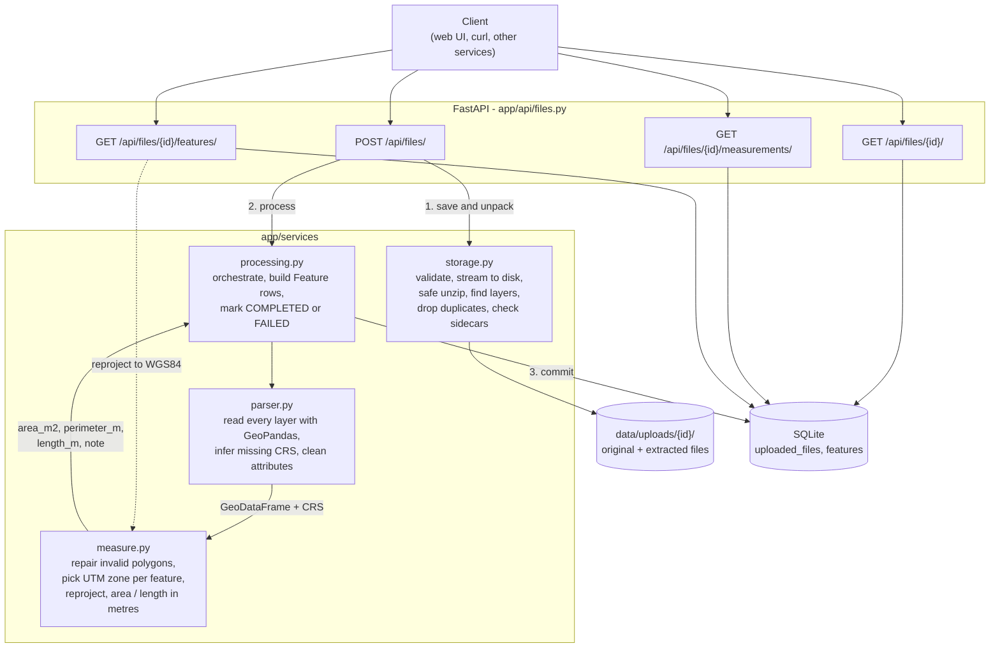

# geomeasure-api

A FastAPI service that accepts a Shapefile (as a .zip) or a KML file, extracts every feature with its geometry, CRS and attributes, and returns area and length in metres. Coordinates are never measured in degrees: each geometry is reprojected into a suitable projected CRS first.

It also ships a small web page for uploading files and checking the results on a map.

## Contents

- [Setup](#setup)
- [Running](#running)
- [API](#api)
- [Architecture](#architecture)
- [Design decisions](#design-decisions)
- [Testing](#testing)
- [Learnings](#learnings)
- [Future scope](#future-scope)
- [Architecture diagram](#architecture-diagram)

## Setup

Requires Python 3.11 or newer. GDAL does not need to be installed separately; the `pyogrio` wheels bundle it on Windows, macOS and Linux.

```bash
git clone https://github.com/sai-vidith/geomeasure-api.git
cd geomeasure-api
python -m venv .venv

# Windows
.venv\Scripts\activate
# macOS / Linux
source .venv/bin/activate

pip install -r requirements.txt
```

Optional configuration through environment variables (or a `.env` file):

| Variable | Default | Purpose |
|---|---|---|
| `GEOMEASURE_DATA_DIR` | `data` | Where uploads are stored |
| `GEOMEASURE_DATABASE_URL` | `sqlite:///data/geomeasure.db` | SQLAlchemy database URL |
| `GEOMEASURE_MAX_UPLOAD_MB` | `50` | Upload size limit |

## Running

```bash
uvicorn app.main:app --reload
```

- Web UI: http://localhost:8000
- Interactive API docs (Swagger): http://localhost:8000/docs

The `samples/` folder has files to try:

| File | What it shows |
|---|---|
| `site_survey.kml` | Three KML folders: plots (polygons), access tracks (lines), ground control points |
| `parcels_utm.zip` | The same plots as a shapefile in UTM zone 43N (EPSG:32643) |
| `parcels_no_prj.zip` | The plots in WGS84 with the `.prj` removed, to show CRS inference |

All three produce the same total plot area, 277,466.821 m², which is a useful sanity check that the CRS handling is consistent across formats.

Run `python scripts/make_samples.py` to regenerate them.

## API

| Method | Path | Description |
|---|---|---|
| `POST` | `/api/files/` | Upload and process a `.zip` (Shapefile) or `.kml` |
| `GET` | `/api/files/` | List recent uploads |
| `GET` | `/api/files/{id}/` | File information |
| `GET` | `/api/files/{id}/measurements/` | Per-feature measurements and a summary |
| `GET` | `/api/files/{id}/features/` | All features as GeoJSON with attributes |
| `DELETE` | `/api/files/{id}/` | Delete an upload and its stored files |
| `GET` | `/health` | Liveness check |

### Upload

```bash
curl -F "file=@samples/site_survey.kml" http://localhost:8000/api/files/
```

`201 Created`

```json
{
  "id": "fd99e46f36ad",
  "filename": "site_survey.kml",
  "file_type": "kml",
  "status": "COMPLETED",
  "crs": "EPSG:4326",
  "feature_count": 8,
  "layers": [
    { "name": "Plots", "crs": "EPSG:4326", "feature_count": 3 },
    { "name": "Access tracks", "crs": "EPSG:4326", "feature_count": 2 },
    { "name": "Ground control points", "crs": "EPSG:4326", "feature_count": 3 }
  ],
  "warnings": [],
  "error": null,
  "created_at": "2026-10-10T15:55:32.077702Z"
}
```

Status codes:

| Code | When |
|---|---|
| `201` | File processed. `status` is `COMPLETED`. |
| `400` | Rejected before processing: wrong extension, empty file, over the size limit, not a zip, no `.shp` in the zip, or an archive entry that tries to escape the upload folder. Nothing is stored. |
| `422` | Accepted but GDAL could not read it (e.g. a truncated KML). The body is the stored record with `status: "FAILED"` and an `error` message, so it can still be looked up by id. |

A shapefile with missing sidecar files is still processed where possible, and the response explains what was done:

```json
"warnings": [
  "Missing .prj for 'parcels_no_prj.shp' (.prj: CRS is unknown and will be inferred from the coordinates if possible)",
  "CRS missing; coordinates look like longitude/latitude, assumed EPSG:4326"
]
```

### File information

```bash
curl http://localhost:8000/api/files/fd99e46f36ad/
```

Returns the same shape as the upload response. `404` if the id does not exist.

### Measurements

```bash
curl http://localhost:8000/api/files/fd99e46f36ad/measurements/
```

```json
{
  "file_id": "fd99e46f36ad",
  "crs": "EPSG:4326",
  "summary": {
    "total_area_m2": 277466.821,
    "total_length_m": 1636.465,
    "measured_features": 5,
    "unmeasured_features": 3,
    "geometry_types": { "Polygon": 3, "LineString": 2, "Point": 3 }
  },
  "features": [
    {
      "index": 0,
      "layer": "Plots",
      "geometry_type": "Polygon",
      "area_m2": 75459.393,
      "perimeter_m": 1109.57,
      "length_m": null,
      "measurement_crs": "EPSG:32643",
      "note": null
    },
    {
      "index": 3,
      "layer": "Access tracks",
      "geometry_type": "LineString",
      "area_m2": null,
      "perimeter_m": null,
      "length_m": 1001.065,
      "measurement_crs": "EPSG:32643",
      "note": null
    },
    {
      "index": 5,
      "layer": "Ground control points",
      "geometry_type": "Point",
      "area_m2": null,
      "perimeter_m": null,
      "length_m": null,
      "measurement_crs": null,
      "note": "Point geometry: no measurement required"
    }
  ]
}
```

(Trimmed to three features.) `measurement_crs` tells you which projection each number was computed in. `409` is returned if the file failed processing.

### Features

```bash
curl http://localhost:8000/api/files/fd99e46f36ad/features/
curl "http://localhost:8000/api/files/fd99e46f36ad/features/?crs=source"
```

Returns a GeoJSON `FeatureCollection` with every feature's ID, geometry, CRS, attributes and measurements. Geometry is in WGS84 by default, as RFC 7946 requires, so it can go straight into Leaflet, Mapbox or QGIS. `?crs=source` returns the coordinates exactly as they were in the uploaded file. App-generated fields are prefixed with `_` so they cannot collide with the file's own attributes.

```json
{
  "type": "Feature",
  "id": 0,
  "geometry": { "type": "Polygon", "coordinates": [[[77.5962, 13.1987, 0.0], "..."]] },
  "properties": {
    "Name": "Plot A",
    "_layer": "Plots",
    "_geometry_type": "Polygon",
    "_crs": "EPSG:4326",
    "_area_m2": 75459.393,
    "_perimeter_m": 1109.57,
    "_length_m": null,
    "_note": null
  }
}
```

## Architecture

### Application structure

```
app/
  main.py              App setup, router and static file wiring
  config.py            Settings, overridable with GEOMEASURE_* env vars
  database.py          SQLAlchemy engine and session dependency
  models.py            UploadedFile and Feature tables
  schemas.py           Pydantic response models
  api/files.py         HTTP routes; no GIS logic here
  services/
    storage.py         Saving uploads, safe unzipping, finding shapefile layers
    parser.py          Reading layers with GeoPandas, CRS inference, attribute cleanup
    measure.py         Choosing a projected CRS and computing area/length
    processing.py      Ties parser and measure together and fills the database rows
  static/              Web UI (plain HTML, CSS and JS with Leaflet)
tests/                 pytest suite
samples/               Example files
scripts/               Sample generator
```

Routes only deal with HTTP. Everything geospatial lives in `services/`, which has no FastAPI imports, so it can be tested directly or reused from a background worker later.

### File-processing flow

1. **Validate.** The extension must be `.zip` or `.kml`. The upload is streamed to disk in 1 MB chunks and aborted once it passes the size limit, so a large file is never held in memory.
2. **Unpack (shapefiles only).**
   - Every zip entry's path is resolved before extraction and rejected if it would land outside the upload folder (zip slip).
   - Archives that would expand to more than 10x the upload limit are refused.
   - All `.shp` files are collected, case-insensitively and in any subfolder, ignoring `__MACOSX` resource forks.
   - Byte-identical copies (same `.shp`, `.dbf` and `.prj`) are processed once and reported in `warnings`. Every distinct shapefile becomes its own layer.
   - Missing sidecar files are collected per layer and reported together:

     | Missing | What happens |
     |---|---|
     | `.shx` | GDAL rebuilds the index from the `.shp` (`SHAPE_RESTORE_SHX`) |
     | `.dbf` | Geometry and measurements are still returned; attributes are empty |
     | `.prj` | CRS is inferred if possible (see CRS handling) |
     | `.shp` | Nothing to read, so the upload is rejected with `400` |

3. **Read.** Each layer is loaded into a GeoDataFrame. A KML file is read **layer by layer**: GDAL exposes every KML `<Folder>` as a separate layer, and `geopandas.read_file()` without a layer name silently returns only the first one.
4. **Extract.** For every feature the service stores a global index, layer name, geometry type, GeoJSON geometry (in the source CRS), CRS label and cleaned attributes. Cleaning drops nulls, NaN/NaT and KML rendering flags, and converts numpy and datetime values to plain JSON.
5. **Measure** (next section), then save everything in one transaction. If any step raises, the record is saved as `FAILED` with the error message and no partial features.

### Measurement calculation flow

For each feature:

| Geometry | Result |
|---|---|
| Polygon, MultiPolygon | `area_m2` and `perimeter_m` |
| LineString, MultiLineString | `length_m` |
| Point, MultiPoint | No measurement; a note says so |
| GeometryCollection, empty or null | No measurement; a note explains why. Never a crash. |

Before measuring, an invalid polygon (for example a self-intersecting "bow-tie", whose two lobes cancel to an area of 0) is repaired with `shapely.make_valid(method="structure")`, and the feature's note records that it was repaired.

The geometry is then projected into the measurement CRS (below), and area and length are read from the projected coordinates. If that CRS uses feet or another non-metre unit, the result is converted using the unit factor from the CRS definition. Values are rounded to millimetres.

### CRS handling

The CRS is taken from the file: the `.prj` for shapefiles, and always WGS84 for KML, as the KML spec requires.

If a shapefile has no `.prj`:
- If every coordinate fits within longitude/latitude ranges, EPSG:4326 is assumed and a warning is added.
- Otherwise the coordinates are in some projected system that cannot be identified. Guessing would produce confident but wrong numbers, so those features are returned without measurements and with a note.

Choosing the CRS to measure in:

| Source CRS | Measured in |
|---|---|
| Projected, metre-based or not (UTM, national grids, state plane in feet) | The source CRS itself, with unit conversion |
| Geographic (EPSG:4326 and other lat/lon systems) | The WGS84 UTM zone containing the feature's centroid |
| Web Mercator or other Mercator variants | Same as geographic: reprojected to UTM |
| Latitudes beyond UTM's range (north of 84°N, south of 80°S) | A Lambert azimuthal equal-area projection centred on the feature |

The zone is picked **per feature**, not per file, so a file with sites in Mumbai (zone 43) and Kolkata (zone 45) measures each one in its own zone. Features wider than one UTM zone (6° of longitude) get a note that accuracy is reduced.

Web Mercator is treated as unsuitable even though it is projected: it inflates area by roughly 1/cos²(latitude), about 2x at 45°. One of the tests demonstrates this.

All transformations use `always_xy=True`. EPSG:4326 officially orders its axes latitude, longitude, while GeoJSON and Shapely use x = longitude. Without that flag the coordinates are silently swapped.

## Design decisions

**Synchronous processing.** The upload request parses and measures the file before responding. The assignment's files are survey-sized (hundreds to a few thousand features) and process in well under a second, so a job queue would add infrastructure without a user-visible benefit. The data model already has a `PROCESSING` status, and the processing code has no HTTP dependencies, so moving it to a background worker is a contained change. Routes are plain `def`, so FastAPI runs them in its thread pool and a slow GDAL read does not block other requests.

**UTM per feature, rather than one CRS for the whole file.** I considered three options:

| Option | Why I did or did not use it |
|---|---|
| A single equal-area projection (e.g. EPSG:6933) | Good for area, distorts lengths |
| `estimate_utm_crs()` once for the whole file | Fine for one site, wrong for files spanning zones |
| Geodesic calculation on the ellipsoid (`pyproj.Geod`) | The most accurate, but the assignment asks for reprojection, and projected geometry is what downstream GIS tools work with |

Inside a UTM zone the scale factor stays between 0.9996 and about 1.001, so per-feature UTM keeps area error within about 0.2% even at a zone's edge, and much less near its centre. The tests use `pyproj.Geod` as an independent reference and require agreement within 0.2%.

**Partial success over rejection.** A shapefile missing its `.dbf`, or a KML with one unsupported GeometryCollection, still yields useful measurements. The service returns what it can, and `warnings` plus per-feature `note`s say what it could not do. Hard `400` errors are reserved for inputs that contain no usable data at all.

**Stored geometry in the source CRS.** The spec asks for the geometry and CRS as they are in the file, so that is what is stored. The WKT of each layer's CRS is stored too, so the features endpoint can reproject to WGS84 on request even for a CRS that has no EPSG code.

**SQLite with SQLAlchemy.** No setup is needed to run the project. Switching to PostgreSQL only means changing `GEOMEASURE_DATABASE_URL`. Geometry is kept as GeoJSON in a JSON column because the service never runs spatial queries on it. If it needed to (e.g. "features within this boundary"), PostGIS would be the right move.

**No frontend framework.** The UI is roughly 300 lines of plain JavaScript and Leaflet served by FastAPI itself, so the project stays a single process with no build step. All text taken from uploaded files is HTML-escaped before rendering.

## Testing

```bash
pytest
```

36 tests, covering:

- **Upload validation:** extension, empty file, non-zip, zip without `.shp`, zip slip, corrupt KML stored as `FAILED`, 404s.
- **Archives:** multiple distinct layers, duplicate copies, missing `.shx`, `.dbf` or `.prj` (with lon/lat and with projected coordinates), all missing parts reported in one warning, uppercase extensions in nested folders.
- **Measurement accuracy against `pyproj.Geod`:**
  - polygons and lines in WGS84
  - native UTM
  - US survey feet (EPSG:2263)
  - Web Mercator
  - repaired bow-tie polygons
  - features in different UTM zones
  - polar fallback
  - UTM zone selection at hemisphere and antimeridian edges
- **Response shape:** GeoJSON output in both CRS modes, property cleanup, UTC timestamps.

Test files are generated on the fly from known geometries (e.g. an exact 1000 m x 1000 m UTM square), so every expected value is computed rather than copied from a previous run.

## Learnings

- **"Read the file" is not one call.** I first assumed `geopandas.read_file()` returns everything in a KML. It returns the first folder only. Listing the layers with `pyogrio.list_layers()` and reading each one fixed it, and a test now guards it.
- **A projected CRS is not automatically safe to measure in.** I initially planned to trust any projected source CRS. Then I checked Web Mercator: a 1 km² square at 45° latitude comes out at about 2 km². Projection families matter, not just "projected vs geographic".
- **Axis order.** EPSG:4326 is defined as latitude, longitude, but every library I used works in longitude, latitude. `always_xy=True` is the kind of flag that is invisible when right and silently wrong when missing.
- **Shapefiles are bundles.** Working through what each sidecar file does (`.shx` can be rebuilt, `.dbf` is optional for geometry, `.prj` is the CRS) changed my error handling from "reject anything incomplete" to "do what is possible and say what was skipped".
- **Silent data loss in pandas.** A shapefile without a `.dbf` gave a DataFrame with rows but no columns, and `to_dict("records")` returned an empty list, so `zip()` dropped every feature without an error. Using `zip(..., strict=True)` makes this kind of mismatch fail loudly.

## Future scope

- **Background processing** with a task queue (Celery/RQ or arq) for very large files, using the existing `PROCESSING` status and polling `GET /api/files/{id}/`.
- **More formats:** GeoJSON, GeoPackage and KMZ are a few lines each, since GDAL already reads them.
- **PostGIS** for storage and spatial queries, plus Alembic migrations instead of `create_all`.
- **Pagination** on the measurements and features endpoints for files with tens of thousands of features.
- **Geodesic measurements** as an option (`?method=geodesic`), useful for features that span several UTM zones.
- **Antimeridian-crossing geometries** (e.g. Pacific islands) need splitting before the centroid-based zone selection is reliable.
- **Docker image and CI** (GitHub Actions running the test suite).
- **3D measurements.** Surface area and slope-aware length using the Z values that drone surveys usually carry; currently Z is ignored and results are planimetric.

## Architecture diagram


